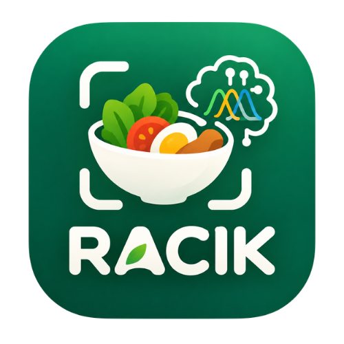

# Racik

<p align="center">
  
</p>

Aplikasi mobile pemindai makanan berbasis kecerdasan buatan (Flutter + Supabase + TensorFlow Lite).

## Menjalankan

1. Buat project di [supabase.com](https://supabase.com), buka **SQL Editor**, jalankan
   `supabase/schema.sql` lalu `supabase/seed.sql`.
   Project yang sudah memakai `schema.sql` versi lama cukup menjalankan
   `supabase/patch-01-perbaikan-bug.sql`, `supabase/hapus_akun.sql`, lalu
   `supabase/patch-02-perbaikan-bug.sql`, lalu `supabase/patch-03-foto-kandidat.sql` sekali.
   Foto resep contoh: unggah isi `supabase/gambar-resep/` ke Storage
   `food-images/resep/`, lalu jalankan `supabase/foto-resep-contoh.sql`
   (kredit foto: `supabase/gambar-resep/KREDIT.md`).
2. Untuk masa pengembangan, matikan **Authentication → Sign In / Providers → Email → Confirm email**.
3. Salin `env.example.json` menjadi `env.json`, lalu isi dengan URL dan **publishable key** Supabase:

   ```json
   {
     "SUPABASE_URL": "https://<ref>.supabase.co",
     "SUPABASE_KEY": "sb_publishable_..."
   }
   ```

   Kunci OpenRouter **tidak** disimpan di aplikasi. Kunci itu dipasang sebagai secret
   Supabase Edge Function `recognize-food`:

   ```bash
   supabase secrets set OPENROUTER_API_KEY=sk-or-... --project-ref <ref>
   supabase functions deploy recognize-food --project-ref <ref>
   ```

   Aktifkan juga pengaman rahasia (sekali per clone). Commit akan ditolak bila memuat
   `env.json`, keystore, `key.properties`, atau isi yang mirip API key/password:

   ```bash
   git config core.hooksPath .githooks
   ```

4. Jalankan:

   ```bash
   flutter pub get
   flutter run --dart-define-from-file=env.json
   ```

   Belum men-deploy Edge Function? Tambahkan `--dart-define=AI_DEMO=true` untuk mode demo.

5. Daftar akun lewat aplikasi, lalu jadikan admin di SQL Editor:

   ```sql
   update public.users set role = 'admin' where username = 'username_anda';
   ```

Aplikasi mengenali makanan dengan model Vision AI **Qwen 2.5 VL 72B** lewat Supabase Edge Function
`recognize-food` (atau mode demo). Makanan yang belum terdaftar disimpan sebagai resep yang menunggu
verifikasi admin, lalu skor kesehatannya dihitung dengan **Logika Fuzzy Sugeno**.

Rilis ke Google Play (package `com.racik.app`, upload key, kebijakan privasi, hapus akun):
lihat `store/PANDUAN-PUBLIKASI.md`.

## Struktur

```
lib/
  main.dart, app.dart   titik masuk, Provider, AuthGate (layar per aktor)
  core/                 konfigurasi, tema, format, pesan error
  models/               satu kelas per tabel ERD
  services/             akses Supabase, satu file per kelompok use case
  ai/                   pengenal makanan (TFLite/demo) + skor fuzzy
  providers/            state login & model AI
  widgets/              komponen yang dipakai ulang
  screens/              layar, dikelompokkan per fitur
supabase/               schema.sql (tabel, trigger, RLS, storage) + seed.sql
test/                   tes logika fuzzy dan parsing model
```
